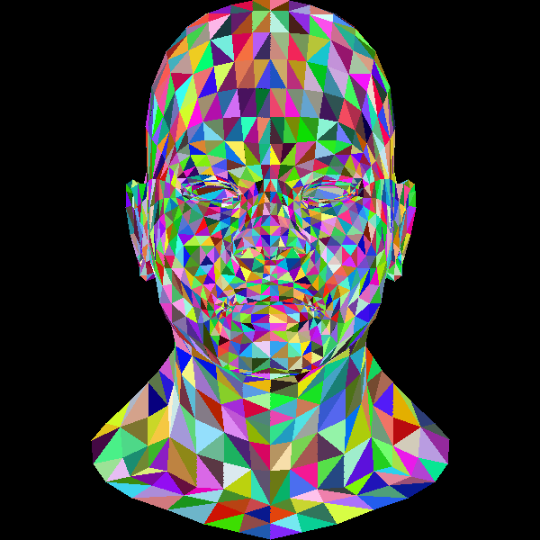

# tinyrenderer

A software renderer in Rust, built from scratch by following Dmitry Sokolov's
[tinyrenderer](https://github.com/ssloy/tinyrenderer) course. There's no GPU or
graphics API involved: every pixel is computed on the CPU and shown in a window
with [minifb](https://crates.io/crates/minifb).



## Progress

- [x] Lines
- [x] Filled triangles: first scanline, now bounding box + barycentric coordinates
- [x] OBJ model loading
- [x] Orthographic projection onto the screen
- [x] Back-face culling, from the winding of the projected triangle
- [x] Z-buffer, with depth interpolated from barycentric weights
- [ ] Flat shading from face normals
- [ ] Perspective projection and a camera
- [ ] Textures and smooth shading

## Running

```sh
cargo run --release
```

The window closes with Escape or Q.
